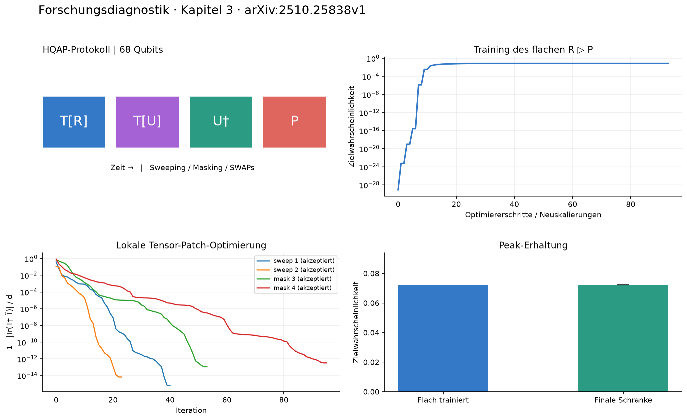
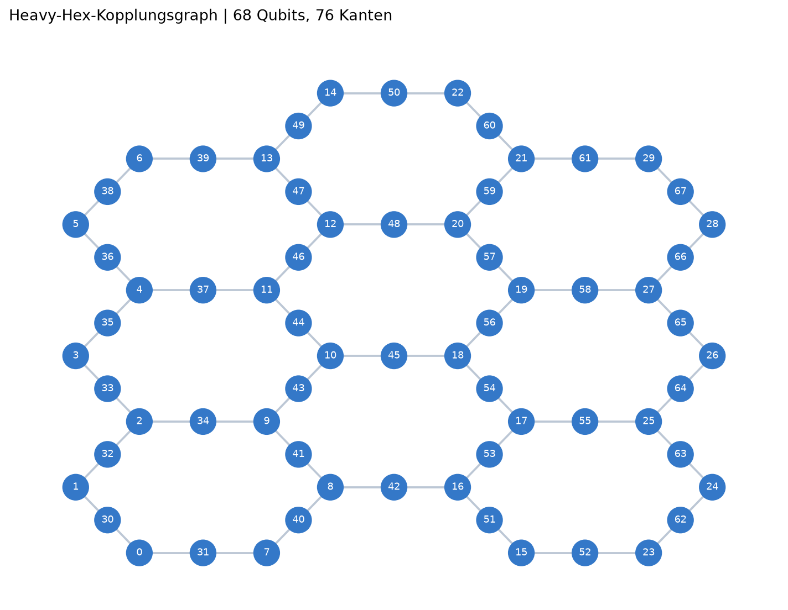

# Gemessene Ergebnisse

Die Zahlen stammen aus tatsächlich ausgeführten lokalen Läufen mit Seed 7.
Die Gitter sind ideale unterteilte Hexagongitter, keine kalibrierten IBM-Geräte.
Alle Winkel und Zwischenstände liegen neben den jeweiligen report.json-Dateien.

## Peakgewichte

| Qubits | Zielgewicht / untere Schranke | In Prozent | Art der Auswertung | RZZ-Gates | SWAP-Gates |
|---:|---:|---:|---|---:|---:|
| 8 | 0.9301694465 | 93.01694 % | direkte finale Kontraktion | 70 | 134 |
| 35 | 0.2378666678 | 23.78667 % | untere finale Schranke | 226 | 102 |
| 68 | 0.07224847356 | 7.224847 % | untere finale Schranke | 449 | 62 |
| 164 | 3.765832529e-05 | 0.003765833 % | untere finale Schranke | 1089 | 58 |

Der 8-Qubit-Lauf wurde vollständig und ohne Bond-Trunkierung kontrahiert.
Die 35-, 68- und 164-Qubit-Zeilen beruhen auf exakt kontrahierten flachen
Schaltkreisen und der dokumentierten Operatornormschranke für die lokalen
Ersetzungen. Die fertigen tiefen Schaltkreise dieser Größen wurden nicht
vollständig simuliert.

**68 Qubits erreichen die gewählte Schwelle von 1 %.** Die getesteten
164 Qubits liefern eine positive Peak-Schranke, erreichen diese Schwelle
aber nicht. Das ist weder eine obere Grenze möglicher Qubitzahlen noch ein
Nachweis von Quantenvorteil. Die Schwelle 1 % ist eine eigene Konfiguration
für diese Tests, kein Satz aus dem Paper.

Ein Gate in der Tabelle bezeichnet ein abstraktes RZZ oder SWAP. Im portablen
QASM-2-Export braucht jedes RZZ zwei CX und jedes SWAP drei CX. Ein Vergleich
mit Hardware-Gatezahlen muss diese Zerlegung berücksichtigen.

## Durch Tests ausgelöste Verbesserungen

1. **Gitter:** Das Standardgitter setzt die IBM-Zellbeschreibung direkt um.
   Der ähnlich benannte Qiskit-Codegraph hat andere Randzyklen.
2. **Bit- und Zeitordnung:** Drei Simulatoren und die zwei vorhandenen
   Quimb-Module stimmen bei identischen Eingaben überein.
3. **Sehr kleine Gewichte:** Wahrscheinlichkeiten werden separat gespeichert;
   die Subtraktion 1-L hätte Werte weit unter Maschinengenauigkeit ausgelöscht.
4. **Optimierung:** Kontrollierte Neuskalierungen verhindern, dass die
   Liniensuche nach enormer Verbesserung durch die alte Skalierung scheitert.
   Beim 164-Qubit-Vergleich blieb die feste Variante bei
   1.16067e-30 stehen (ABNORMAL-Abbruch).
   Die verbesserte Variante erreichte 3.76833e-05
   mit 11 Neuskalierungen.
   Beide hatten maximal 180 Sekunden Trainingsbudget; ihre tatsächlich
   verbrauchte Zeit war unterschiedlich. Das ist ein Funktionsvergleich,
   kein isolierter Geschwindigkeitsbenchmark.
5. **QASM:** Der Rückimporttest fand undefinierte erweiterte Gates.
   Explizite Zerlegung in CX und Rotationen macht alle neun gespeicherten
   Exporte mit dem strikten QASM-2-Importer lesbar.

## Prüfstand

**39 Tests bestanden**, keine Fehlschläge, keine übersprungenen Tests.
Maschinenlesbarer Prüfbericht: results/tests.xml.

Die Suite prüft unter anderem Gradienten gegen finite Differenzen und
Parameter Shift, Trace-Loss und globale Phase, Patch-Kausalität,
abgelehnte Ersetzungen, SWAP-Transformationen auf beliebigen Eingangszuständen,
Ressourcenbegrenzung, nichttriviale Zielbitstrings, Reproduzierbarkeit und
QASM-Export/Rückimport.

Referenzvergleich in results/comparison.json:

- circuits.py und functions.py: maximaler Zustandsvektorfehler ca. 1.7e-16.
- Eigener Simulator gegen Quimb: ca. 9.6e-16; gegen Qiskit unter den getesteten
  Operationen numerisch identisch.
- Öffentliche 49-Qubit-Datei: 12109 Gates, davon 4020 CZ. Ein inneres Fenster
  mit 18 Gates auf 8 Qubits stimmt ebenfalls bis auf Rundungsfehler überein.
  Der Peak des vollständigen externen Benchmarks wurde nicht verifiziert.

## Ergebnisordner

- results/demo: direkt überprüfter 8-Qubit-Lauf, sieben Checkpoints,
  vollständige Grafiken, Kopplungsgraph und portabler QASM-Export.
- results/large68: verbesserter 68-Qubit-Lauf, Trainingsbudget 120 Sekunden.
- results/large164_rescaled: verbesserter 164-Qubit-Lauf, Budget 180 Sekunden.
- results/large164: historische Vergleichsvariante mit einer festen Skalierung.
- results/scaling: historische kurze Baseline (12, 35, 68, 111, 164 Qubits),
  jeweils höchstens 30 Sekunden Training und 60 Schritte.
- results/middle.png und results/middle_tn.png: Fenster mitten im maskierten
  Demonstrationsnetzwerk, ohne erneutes Training erzeugt.

Zeitbudgets werden zwischen Zielfunktionsauswertungen geprüft. Einzelne
Operationen können sie überschreiten. Einige Kontrollarbeiten liefen
gleichzeitig; Laufzeiten sind deshalb Orientierungswerte für diesen Rechner.
Es wurden keine Hardwarejobs eingereicht.

